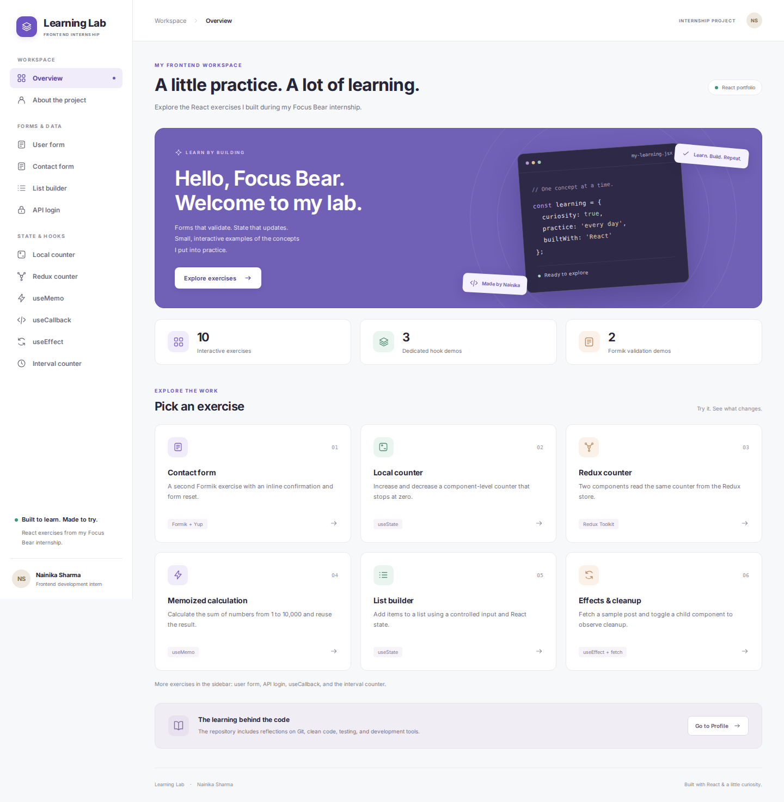

# Learning Lab — Focus Bear Frontend Internship

A React portfolio of the exercises I completed during my frontend development
internship with Focus Bear. The website puts the existing forms, counters,
routing, and hook examples into one workspace with an overview, exercise cards,
and responsive navigation.

**Author:** Nainika Sharma  
**Source repository:** [NainikaSharma-intern-repo](https://github.com/NainikaSharma/NainikaSharma-intern-repo)

## Preview and verification



See [verification results](docs/verification.md) and the desktop/mobile
screenshots in `docs/`.

## Run the main website

Install Node.js and npm. From the application folder containing `package.json`, run:

```powershell
npm ci
npm start
```

Open [http://localhost:3000](http://localhost:3000). The application opens on the
overview. Each sidebar item opens a working exercise. Node.js 24 was used for
validation; the lockfile records the installed dependency versions.

## Available pages

| URL              | Exercise             | Behaviour                                                                                                                                       |
| ---------------- | -------------------- | ----------------------------------------------------------------------------------------------------------------------------------------------- |
| `/` or `/home`   | Overview             | Exercise cards and navigation to the project profile.                                                                                           |
| `/profile`       | About the project    | Author, technologies, and reflection filenames.                                                                                                 |
| `/form`          | User form            | Requires a name of at least two characters and a valid email. Shows an inline confirmation; retains the values.                                 |
| `/formik`        | Contact form         | Uses the existing `App.jsx` form. Validates name and email, shows the submitted values, and resets the fields.                                  |
| `/list`          | List builder         | Adds nonblank input to an in-memory list and clears the input.                                                                                  |
| `/login`         | API login            | Sends the prefilled ReqRes demo credentials, stores a returned token, and displays request outcomes. Labels switch between English and Spanish. |
| `/counter`       | Local counter        | Increases or decreases the value; stops at zero.                                                                                                |
| `/redux-counter` | Redux counter        | Updates the shared store and displays a message based on the value. Stops at zero.                                                              |
| `/memo`          | Memoized calculation | Sums 1–10,000 to 50,005,000. Re-rendering increments a separate count without changing the numbers dependency.                                  |
| `/callback`      | Stable callbacks     | Updates a parent counter while passing a memoized callback to a memoized child.                                                                 |
| `/effect`        | Effects and cleanup  | Fetches sample post 1 and toggles a child with mount/unmount console messages.                                                                  |
| `/buggy-counter` | Interval counter     | Retains the corrected stale-closure example: increments every second and clears its interval on unmount.                                        |

Unknown URLs show a page with a link back to the overview. `/` now opens the
overview; the original login exercise is available at `/login`.

## External API configuration

Most exercises work without an API key. Only the login demo needs a ReqRes key.
The post request at `/effect` needs an internet connection.

1. Read the [ReqRes API documentation](https://reqres.in/docs) and obtain a
   demo-only public API key suitable for requests from a browser.
2. In the `project` directory, copy the example configuration:

   ```powershell
   Copy-Item .env.example .env.local
   ```

3. Set the value in `.env.local`:

   ```dotenv
   REACT_APP_REQRES_API_KEY=your_demo_public_key
   ```

4. Restart `npm start`. The Axios client sends this value as `x-api-key`.

The prefilled fixture credentials are `eve.holt@reqres.in` / `cityslicka`.
Provider access and API-key policy determine whether a live request succeeds.
Missing configuration produces an explicit message; rejected requests show
the HTTP status. No request is presented as successful unless a token returns.

`REACT_APP_*` values are included in the browser bundle. Use this setup only
with a demo/public key. It is not a place for a secret production key.

## Checks

Run these commands from `project`:

```powershell
npm test -- --watchAll=false --runInBand
npm run build
npm run lint
```

- Tests cover addition, the local counter, message updates, a mocked user
  request, and the Redux reducer/selector.
- `npm run build` writes the production website to `build`.
- `npm run lint` checks source files without changing them.
- `npm run lint:fix` applies ESLint fixes; `npm run format` formats files.
- `npm run format:check` checks source formatting.

The original workflow at `.github/workflows/ci.yml` checks Markdown and
spelling. GitHub discovers it when this application folder is the Git
repository root. If the Git root is its parent folder, the workflow needs to
be placed in that root's `.github/workflows` directory. Original reflection
files are preserved and may have their own Markdown/spelling findings.

## Repository contents

| Location                    | Contents                                                         |
| --------------------------- | ---------------------------------------------------------------- |
| `src/index.js`      | Explicitly loads `App.js`, Redux, and the i18next configuration. |
| `src/App.js`        | Website shell, sidebar, page headings, and routes.               |
| `src/App.jsx`       | Existing contact-form exercise, now reachable at `/formik`.      |
| `src/exercises.js`  | Navigation titles and instructions for the ten exercises.        |
| `src/App.css`       | Shared layout, exercise styles, and mobile breakpoints.          |
| `src/components/`   | Existing reusable button/list and the new SVG icon component.    |
| `src/redux/`        | Store, counter slice, and reducer tests.                         |
| `src/api/`          | Existing Axios client and request helpers.                       |
| `*.md`              | Internship reflections and learning notes.                       |
| `formik-form-demo/` | Separate Vite starter preserved as uploaded.                     |

The reflections include Git, React fundamentals, hooks, Formik, i18next,
clean code, testing, AI tools, Chrome extensions, VS Code shortcuts, learning
goals, and the company reflection. Their content has not been rewritten.
Other code examples, Python exercises, and practice files are retained.

The separate `formik-form-demo` folder contains the Vite starter screen,
not the main website. To run that original exercise separately:

```powershell
cd formik-form-demo
npm ci
npm run dev
```

## Data and scope

- Form submissions are local demonstrations. They do not create accounts or
  send contact details to a database.
- List and component state reset when their page unmounts. Redux state lasts
  across navigation but resets on a browser reload.
- The ReqRes token uses the existing `localStorage` approach. No route is
  protected, and this is not Focus Bear's production authentication system.
- `UserList.js` remains a unit-test example with a mocked API. Its placeholder
  `https://example.com/users` endpoint is not advertised as a live user service.
- Payment/task/user request helper files are retained as exercises; the site
  does not claim to implement a payment or task-management product.
- A production host must serve `index.html` for route URLs such as `/counter`
  so direct visits and refreshes work with BrowserRouter.

## Frontend changes

The interface adds a purple overview banner, exercise cards, active sidebar
links, mobile navigation, exercise instructions, an author profile, keyboard
focus styles, a skip link, labelled inputs, inline messages, and updated page
metadata. The counter rules, Redux actions, hook calculations, timer cleanup,
Formik validation rules, and original written work are retained.

The entry point now loads i18next and explicitly selects `App.js`. The unused
contact form in `App.jsx` is accessible as its own exercise. The duplicate
reducer in `counterSlice.test.js` was replaced with tests of the actual slice.
Dependency versions were aligned with the existing Create React App toolchain.

## License

MIT. See [LICENSE](LICENSE). The self-hosted Inter font is distributed under
the SIL Open Font License; see `src/fonts/LICENSE.txt`.
